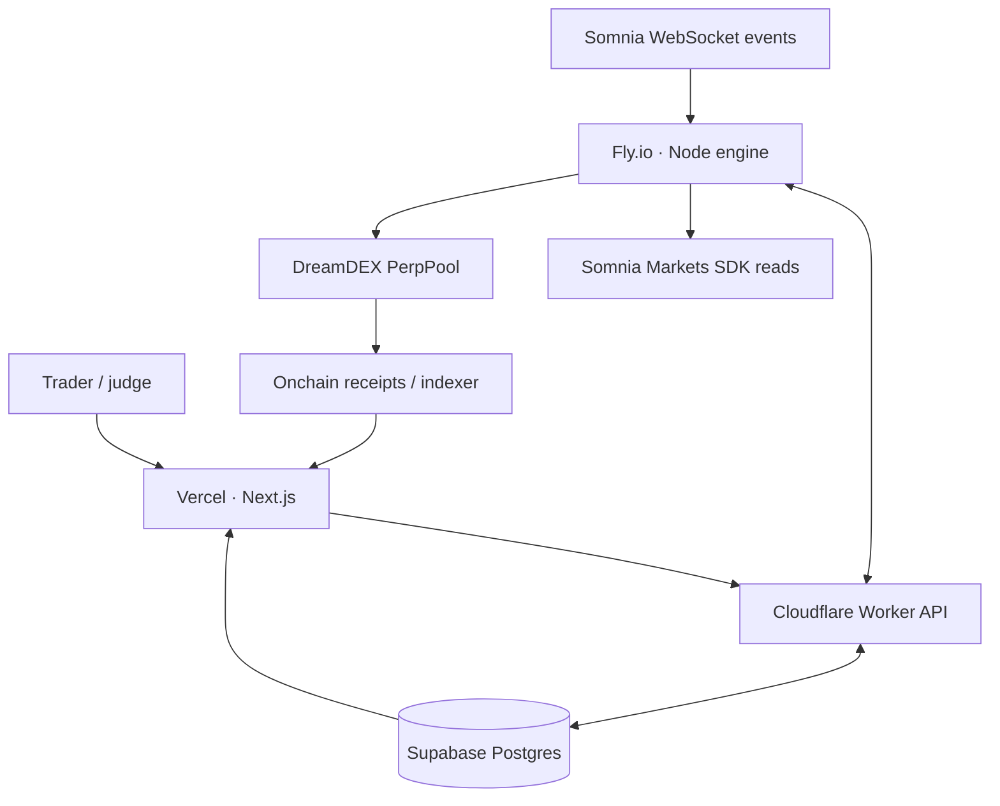

# THRYNT

**Set the condition. Prove the execution.**

THRYNT is an open-source, event-driven DreamDEX perpetuals automation and decision-audit system targeting **Somnia Hideki testnet** (chain ID **50383**). It combines no-code deterministic rules, account-level safety gates, permissioned order execution and inspectable decision traces.

This repository contains source code and deployment configuration. **It is not a deployed, verified, or audited trading service.** Real testnet trading requires independently verified SDK compatibility, controlled account funding, explicit owner permission and two separate opt-in controls.

## Stack

| Layer | Technology | Responsibility |
|---|---|---|
| Frontend | Vercel, Next.js 15, React 19, TypeScript, CSS | Seven responsive trading-control views, owner sign-in |
| API | Cloudflare Workers, Hono | Protected owner writes, engine messages, public redacted reads |
| Database | Supabase Postgres | Versions, snapshots, traces, deduplication, leases, transactions |
| Execution | Fly.io worker, Node 22 | WebSocket listener, deterministic rules, risk checks, bot signer |
| Market data | Somnia Markets SDK 0.32.1 | Market discovery, current account/pricing state, protocol sizing |
| Trades | DreamDEX PerpPool linked bot | Authorized `placeOrderFor` on Hideki |
| Proof | Receipts, indexer, explorer | Blockchain outcome independent of THRYNT's offchain log |

## Architecture



The Worker holds Supabase's server key; the Fly worker holds the dedicated linked-bot secret. The browser holds **neither**. There is no Cloudflare Container, Durable Object, D1 database, public Fly signing endpoint or external custody facility.

### Monorepo layout

- `packages/core`: typed rule schema, contradiction validator, deterministic evaluator, risk checks and three strategy templates.
- `apps/web`: Vercel Next.js frontend, read-only judge pages and authorized Strategy Studio.
- `apps/api`: Cloudflare Worker, Supabase API, explicit trader allowlist and engine secret.
- `apps/engine`: Fly-only long-running Node.js process, Somnia observations and linked bot.
- `supabase/migrations`: schema, locked-down access, immutable rule versions and engine lease.
- `docs`: design, threat model, test/deployment verification requirements.

## Strategy Studio

Rules follow **WHEN → IF → THEN → SAFETY → PREVIEW → ARM**.

- One onchain trigger from an actual perp pool (supported event type).
- Up to two condition groups; each holds up to three conditions. Groups and their conditions each support AND/OR.
- No more than two distinct referenced perpetual markets per strategy.
- Allowed market metrics: mark, index, premium, 8h funding, open interest, margin availability and maintenance ratio.
- Exactly one action: bounded trade, notification or strategy pause. A reduction configuration is exposed for simulation, but **live reducing is disabled** until a true linked-bot reduce-only guarantee is verified on Hideki.
- Mandatory account-level validation is always ANDed **after** user conditions; OR never bypasses safety.
- Drafts are versioned and replayable. Arming requires a saved deterministic simulation.

Three templates are included: Cross-Market Confirmation, Funding Divergence and Margin Sentinel. A template is a configuration of the same rule engine, not a separate bot.

## Network

| Parameter | Value |
|---|---|
| Chain | Somnia Hideki |
| Chain ID | 50383 |
| RPC | `https://api.hideki2.infra.testnet.somnia.network` |
| WebSocket | `wss://api.hideki2.infra.testnet.somnia.network/ws` |
| Indexer | `https://hideki-dev.smk.somnia.host/v1/graphql` |
| SDK | `@somnia-chain/markets-sdk@0.32.1` |
| Gas token | STT |
| Perpetual collateral | USDso, per-market address determined from SDK |
| Explorer | https://explorer.testnet.somnia.network/tokyo |

### SDK-specific details

- Reads use the Somnia Markets SDK and its chain WebSocket, not a spot-only DreamDEX HTTP trading endpoint.
- The SDK currently lacks a linked-wallet `placePerpOrderFor` method. The Fly worker uses the officially documented PerpPool `placeOrderFor` via viem, **after** SDK-based sizing and pool-level operator authorization.
- Base decimals, min quantity, tick and lot size are market-specific.
- Funding is a rate for the pool's calculation window; normalize to 8 hours using the reported window.
- DreamDEX's permissioned bot can trade for a linked account, but cannot withdraw collateral or create exchange-held TP/SL on that account.

## Setup for local review

Prerequisites: Node 22+, npm, a newly created Supabase project, and optionally a deployed Worker and funded Hideki testnet bot account.

```bash
npm ci
npm run typecheck
npm test
npm run dev:web
```

Copy `.env.example` into local environment variables; do **not** put real secrets into tracked files. The web UI can run in a disconnected read-only state; it does not fabricate testnet balances or transaction IDs.

1. Apply `supabase/migrations/0001_thrynt.sql` and `0002_account_telemetry.sql` using the Supabase SQL Editor after checking the project target.
2. Enable email link sign-in in Supabase Auth, authorize the correct redirect domain, sign in once, and set the resulting Supabase Auth user UUID as `TRADER_USER_ID` on Cloudflare.
3. Deploy the Cloudflare Worker, setting server-only `SUPABASE_URL`, `SUPABASE_SECRET_KEY`, `ENGINE_API_KEY`, and exact `ALLOWED_ORIGIN`.
4. Deploy the web frontend to Vercel with the public Worker URL and Supabase publishable key.
5. On DreamDEX Hideki, create/fund the OWNER account with USDso margin, create a separate bot key with STT for gas, then Link a Bot for the required perp pools.
6. Configure Fly secrets: `THRYNT_API_URL`, `THRYNT_ENGINE_API_KEY`, `OWNER_ADDRESS`, `BOT_PRIVATE_KEY`, and Somnia endpoints.
7. Start with `EXECUTION_MODE=observe` and `ENABLE_TESTNET_EXECUTION=false`. Confirm successful event observation, immutable trace creation, account telemetry, snapshots, and restart/recovery.
8. For a supervised testnet execution only: enable live mode deliberately on Fly **and** explicitly unpause the global engine via the authenticated dashboard. Use a dedicated small-capital account.

**Do not toggle live execution on a mainnet wallet. This project is Hideki-only.**

### Deploy with Fly (after review)

```bash
fly launch --no-deploy
fly deploy -c apps/engine/fly.toml
fly scale count 1
```

Pass the monorepo root as Docker build context. The worker has **no public HTTP port**. The Fly account may require billing even for a small worker; do not assume an indefinite free allowance.

## Tests and acceptance

```bash
npm run typecheck
npm test
npm run build
```

See [the verification matrix](docs/VERIFICATION.md) before enabling live orders. Type checking and mocked deterministic tests alone are **not** evidence of a real, finalized transaction. For every actual order, verify receipt status, order ID, resting/fill state, correct owner wallet, risk preflight and explorer link.

## Scope boundaries

THRYNT is intended for **one authorized testnet owner account** with a public read-only demo. It does not host arbitrary users' private keys, make AI-selected trading decisions, guarantee profitability or provide managed money services. Signals and skip logs generated by the engine remain offchain application evidence, **not cryptographic proofs** of the evaluator's honesty. Transactions and receipts are independently verifiable.

## Primary references

- [DreamDEX perps developer guide](https://app.dreamdex.io/docs/developers/perps-testnet)
- [DreamDEX linked-bot permissions](https://app.dreamdex.io/docs/trading/link-a-bot)
- [Somnia Markets SDK](https://prd.smk.somnia.host/docs/typescript)
- [DreamDEX official bot kit](https://github.com/somnia-chain/dreamdex-bot-kit)
- [Fly background workers](https://fly.io/learn/background-workers/)
- [Supabase database security](https://supabase.com/docs/guides/database/postgres/row-level-security)

MIT licensed. Inspired by public official SDK and bot-kit integration patterns; no copy of their source files is bundled.
