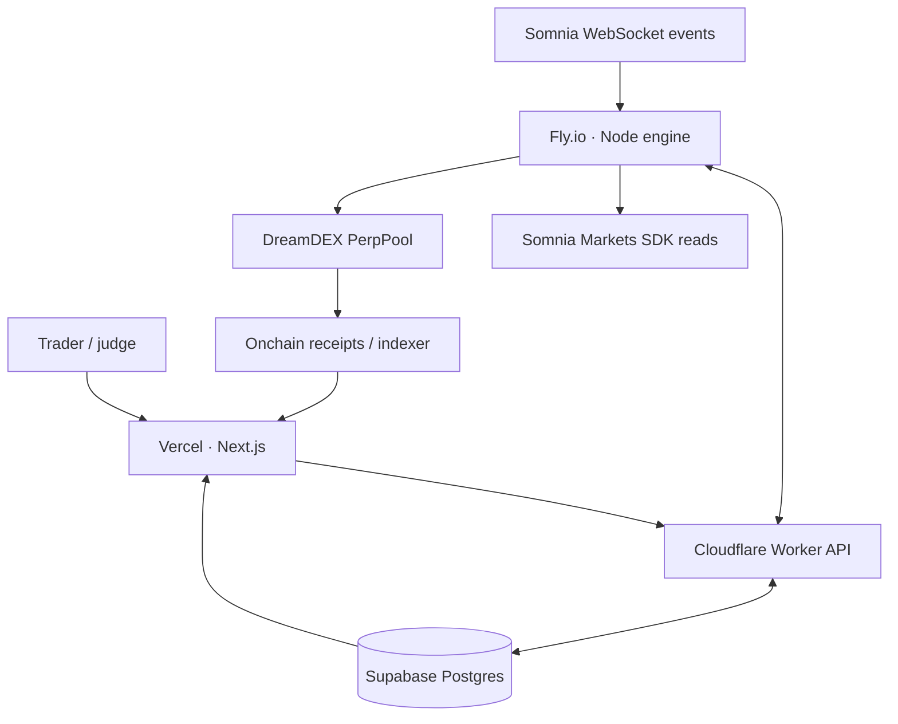

# THRYNT

**Set the condition. Prove the execution.**

THRYNT is an open-source, event-driven DreamDEX perpetuals automation and decision-audit system targeting **Somnia Hideki testnet** (chain ID **50383**). It combines no-code deterministic rules, account-level safety gates, permissioned order execution and inspectable decision traces.

This repository contains source code and deployment configuration. The current Hideki testnet deployments are listed below, but THRYNT is not audited or a managed trading service. One bounded Hideki testnet order was supervised and reconciled on 2026-10-28; live signing is disabled again and the global pause is enabled.

## Stack

| Layer | Technology | Responsibility |
|---|---|---|
| Frontend | Vercel, Next.js 16, React 19, TypeScript, CSS | Seven responsive trading-control views, owner sign-in |
| API | Cloudflare Workers, Hono | Protected owner writes, engine messages, public redacted reads |
| Database | Supabase Postgres | Versions, snapshots, traces, deduplication, leases, transactions |
| Execution | Fly.io worker, Node 22 | WebSocket listener, deterministic rules, risk checks, bot signer |
| Market data | Somnia Markets SDK 0.32.1 | Market discovery, current account/pricing state, protocol sizing |
| Trades | DreamDEX PerpPool linked bot | Authorized `placeOrderFor` on Hideki |
| Proof | Receipts, indexer, explorer | Blockchain outcome independent of THRYNT's offchain log |

## Architecture



The Worker holds Supabase's server key; the Fly worker holds the dedicated linked-bot secret. The browser holds **neither**. There is no Cloudflare Container, Durable Object, D1 database, public Fly signing endpoint or external custody facility.

### Monorepo layout

- `packages/core`: typed rule schema, contradiction validator, deterministic evaluator, risk checks and three strategy templates.
- `apps/web`: Vercel Next.js frontend, read-only judge pages and authorized Strategy Studio.
- `apps/api`: Cloudflare Worker, Supabase API, explicit trader allowlist and engine secret.
- `apps/engine`: Fly-only long-running Node.js process, Somnia observations and linked bot.
- `supabase/migrations`: schema, locked-down access, immutable rule versions, fenced leases and execution-intent reconciliation.
- `docs`: design, threat model, test/deployment verification requirements.

## Strategy Studio

Rules follow **WHEN → IF → THEN → SAFETY → PREVIEW → ARM**.

- One onchain trigger from an actual perp pool (supported event type).
- Up to two condition groups; each holds up to three conditions. Groups and their conditions each support AND/OR.
- No more than two distinct referenced perpetual markets per strategy.
- Allowed market metrics: mark, index, premium, 8h funding, open interest, margin availability and maintenance ratio.
- Exactly one action: bounded trade, notification or strategy pause. A reduction configuration is exposed for validation and simulation, but **live reducing is disabled** until a true linked-bot reduce-only guarantee is verified on Hideki.
- Safety limits include daily and lifetime action caps, expiry, cooldown, maximum notional and total exposure. Lifetime caps are terminal per strategy version; daily caps reset by UTC day.
- Mandatory account-level validation is always ANDed **after** user conditions; OR never bypasses safety.
- Drafts are versioned and replayable. Arming requires a saved deterministic simulation.

Three templates are included: Cross-Market Confirmation, Funding Divergence and Margin Sentinel. A template is a configuration of the same rule engine, not a separate bot.

## Network

| Parameter | Value |
|---|---|
| Chain | Somnia Hideki |
| Chain ID | 50383 |
| RPC | `https://api.hideki2.infra.testnet.somnia.network` |
| WebSocket | `wss://api.hideki2.infra.testnet.somnia.network/ws` |
| Indexer | `https://hideki-dev.smk.somnia.host/v1/graphql` |
| SDK | `@somnia-chain/markets-sdk@0.32.1` |
| Gas token | STT |
| Perpetual collateral | USDso, per-market address determined from SDK |
| Explorer | https://explorer.testnet.somnia.network/tokyo |

### SDK-specific details

- Reads use the Somnia Markets SDK and its chain WebSocket, not a spot-only DreamDEX HTTP trading endpoint.
- The SDK currently lacks a linked-wallet `placePerpOrderFor` method. The Fly worker uses the officially documented PerpPool `placeOrderFor` via viem, **after** SDK-based sizing and pool-level operator authorization.
- Base decimals, min quantity, tick and lot size are market-specific.
- Funding is a rate for the pool's calculation window; normalize to 8 hours using the reported window.
- DreamDEX's permissioned bot can trade for a linked account, but cannot withdraw collateral or create exchange-held TP/SL on that account. The linked-bot `reduceOrderFor` route reduces a resting order's remaining quantity; it is not proof of a reduce-only close for a filled position. Hideki's ETH stop-registry route currently lacks the owner-to-registry authorization required for a safe exchange-held exit, so THRYNT blocks close/reduce submission and does not send an ordinary opposite-side order.

## Setup for local review

Prerequisites: Node 22+, npm, an authorized Supabase project, and optionally a deployed Worker and funded Hideki testnet bot account.

```bash
npm ci
npm run typecheck
npm test
npm run dev:web
```

Copy `.env.example` into local environment variables; do **not** put real secrets into tracked files. The web UI can run in a disconnected read-only state; it does not fabricate testnet balances or transaction IDs.

1. Apply `supabase/migrations/0001_thrynt.sql` through `0006_portfolio_telemetry.sql` using the Supabase CLI or SQL Editor after checking the project target. Never reset an existing project.
2. Enable email link sign-in in Supabase Auth, authorize the correct redirect domain, sign in once, and set the resulting Supabase Auth user UUID as `TRADER_USER_ID` on Cloudflare.
3. Deploy the Cloudflare Worker named `thrynt`, setting server-only `SUPABASE_URL`, `SUPABASE_SECRET_KEY`, `ENGINE_API_KEY`, and exact `ALLOWED_ORIGIN`.
4. Deploy the web frontend to Vercel with the public Worker URL and Supabase publishable key.
5. On DreamDEX Hideki, create/fund the OWNER account with USDso margin, create a separate bot key with STT for gas, then Link a Bot for the required perp pools.
6. Configure Fly secrets: `THRYNT_API_URL`, `THRYNT_ENGINE_API_KEY`, `OWNER_ADDRESS`, `PORT`, and the Somnia endpoints. Store `BOT_PRIVATE_KEY` only in Fly secrets and set `EXPECTED_BOT_ADDRESS` to the linked public bot address; the engine derives the key address and refuses to start live on a mismatch. Possessing the secret is not execution authorization: live mode, the feature flag, global pause and the exact owner-approved preflight remain separate gates.
7. Start with `EXECUTION_MODE=observe` and `ENABLE_TESTNET_EXECUTION=false`. Confirm successful event observation, immutable trace creation, account telemetry, snapshots, and restart/recovery.
8. For a supervised testnet execution only: enable live mode deliberately on Fly **and** explicitly unpause the global engine via the authenticated dashboard. Use a dedicated small-capital account.

**Do not toggle live execution on a mainnet wallet. This project is Hideki-only.**

### Deploy with Fly (after review)

```bash
fly launch --no-deploy
fly deploy -c apps/engine/fly.toml
fly scale count 1 -g worker
```

Pass the monorepo root as Docker build context. The worker exposes only non-secret `/healthz` and `/readyz` endpoints on port 8080 for operational checks; it has no trading API. Keep exactly one active machine because the database lease is the final signing fence. The Fly account may require billing even for a small worker; do not assume an indefinite free allowance.

## Current deployed endpoints

| Component | Endpoint | Observed state |
|---|---|---|
| Vercel | https://thrynt.vercel.app | Production deployment READY; public seven-screen dashboard verified in Chrome |
| Cloudflare Worker | https://thrynt.delealufejoel.workers.dev | `/health` and public telemetry routes respond; owner/engine boundaries reject unauthenticated requests |
| Fly engine | https://thrynt-engine.fly.dev | One machine in `lhr`, observation-only, `/healthz` ready and `/readyz` ready |
| Supabase | `qpvgldadpwiipqgynxzd` | Existing `ACTIVE_HEALTHY` project; migrations 0001–0006 and Auth redirect configuration applied |

## Current verification boundary

The current environment has been verified against Hideki RPC/GraphQL, SDK market discovery, the deployed Fly engine, and genuine pool logs from the Fly runtime. The production engine starts the SDK's snapshot-then-live tail for all five selected pools and the perp plane; its health gate requires live per-market watches, a connected SDK WebSocket and a held database lease. Hideki's public raw WebSocket path can replay late logs and occasionally time out, so receipt-backed raw trigger discovery uses bounded HTTP polling with duplicate and stale-event fencing; the SDK WebSocket remains a required health signal. The Worker public overview reports current real engine/account telemetry: approximately 1,000 USDso-equivalent available margin, one open `-0.004 ETH` position after the supervised IOC fill, current entry/mark/P&L fields, no active resting orders, and global pause enabled. Protective-stop enumeration is explicitly marked partial when the DreamDEX indexer is unavailable; an empty list is never treated as proof that no protection exists. Repeated genuine `OpenInterestUpdated` events are recorded as `BLOCKED` while the pause is active. One approved Supabase Auth identity is configured in the Cloudflare allowlist; its UUID is not stored in frontend code or this repository. The approved session completed authenticated save, simulation, arm and pause operations. The linked DreamDEX bot is authorized on all five discovered live Hideki markets by direct chain reads. The Fly `BOT_PRIVATE_KEY` secret derives the expected linked public bot address and is never exposed to the browser, logs or repository.

## Verified supervised Hideki order

On 2026-10-28, the owner-authorized controlled proof strategy executed exactly one bounded order on Somnia Hideki. The application recorded a genuine BTC `OpenInterestUpdated` event at block `35175550` (event transaction [`0x6af362b2ab8adb07c2b312e21015c0432f3bd82a2b621cf87a46d62ab967b457`](https://explorer.testnet.somnia.network/tokyo/tx/0x6af362b2ab8adb07c2b312e21015c0432f3bd82a2b621cf87a46d62ab967b457)), evaluated immutable strategy `115701c6-0415-4487-b0e2-b82ccb868442` version `8`, and matched the BTC/ETH conditions. The independent risk gateway passed the fresh ETH book, precision, margin, permission, sizing, exposure, cooldown and one-shot intent checks.

- Market/action: `ETH-PERP`, short, IOC, exactly `0.004 ETH`.
- DreamDEX order ID: `16472942457822639999900`.
- Transaction: [`0xdd685a4c40f5a4fd025ff50588442823e57c581cae79e38dcc0877c67da580de`](https://explorer.testnet.somnia.network/tokyo/tx/0xdd685a4c40f5a4fd025ff50588442823e57c581cae79e38dcc0877c67da580de), block `35175637`, receipt `success`.
- Receipt-decoded outcome: one fill, `0.004 ETH` filled at `2348.48 USDso`; the indexed order state is `Filled`, quantity remaining `0`, and no resting IOC order remains.
- The authorized short floor was `max(book-derived 15 bps floor, 2309.60)`. The submitted placement price was `2344.95 USDso`, within the `9.50 USDso` notional and slippage bounds.
- Post-order telemetry reports a real `-0.004 ETH` position. THRYNT did not automatically reverse or close it because a protocol-guaranteed reduce-only route was not independently proven.

The public Decision Trace records the event transaction, strategy version, matched conditions, risk result, intent, receipt status, order ID and reconciled `filled` state. On Hideki, a fully filled IOC can disappear from the active-order read and return `IncorrectOrder()` at the chain head; THRYNT preserves that read error as evidence and uses the DreamDEX indexed order history plus receipt events for the terminal lifecycle state. This is a documented protocol read limitation, not a fabricated success.

After the one broadcast, the engine was returned to `EXECUTION_MODE=observe`, `ENABLE_TESTNET_EXECUTION=false`, and global pause enabled. No further autonomous order submissions are permitted by the deployed configuration.

## Tests and acceptance

```bash
npm run typecheck
npm test
npm run build
npm run test:e2e
npm audit --omit=dev --audit-level=high
```

The current local run reports 15 core tests, 8 engine tests, 6 active production-browser checks on desktop/mobile, and 2 intentionally skipped owner-session checks when no Playwright storage state is supplied. A transient production edge reset was reproduced as a single failed browser request and passed on immediate isolated rerun; it is not treated as a deterministic application failure.

See [the verification matrix](docs/VERIFICATION.md) before enabling live orders. Type checking and mocked deterministic tests alone are **not** evidence of a real, finalized transaction. For every actual order, verify receipt status, order ID, resting/fill state, correct owner wallet, risk preflight and explorer link.

## X posts

The MVP bounty requires two or three genuine posts about THRYNT that tag `@DreamDEXSomnia`. No post URLs are inserted until the owner publishes them; placeholders would be fabricated evidence. Publication-ready drafts and the exact insertion checklist are in [the hackathon submission guide](docs/HACKATHON_SUBMISSION.md).

## Scope boundaries

THRYNT is intended for **one authorized testnet owner account** with a public read-only demo. It does not host arbitrary users' private keys, make AI-selected trading decisions, guarantee profitability or provide managed money services. Filled-position reduction and exchange-held TP/SL remain blocked until DreamDEX exposes a verified owner-authorized route for the linked execution model; the UI states this limitation instead of presenting an unsafe close button. Signals and skip logs generated by the engine remain offchain application evidence, **not cryptographic proofs** of the evaluator's honesty. Transactions and receipts are independently verifiable.

## Primary references

- [DreamDEX perps developer guide](https://app.dreamdex.io/docs/developers/perps-testnet)
- [DreamDEX linked-bot permissions](https://app.dreamdex.io/docs/trading/link-a-bot)
- [Somnia Markets SDK](https://prd.smk.somnia.host/docs/typescript)
- [DreamDEX official bot kit](https://github.com/somnia-chain/dreamdex-bot-kit)
- [Fly background workers](https://fly.io/learn/background-workers/)
- [Supabase database security](https://supabase.com/docs/guides/database/postgres/row-level-security)

MIT licensed. Inspired by public official SDK and bot-kit integration patterns; no copy of their source files is bundled.
