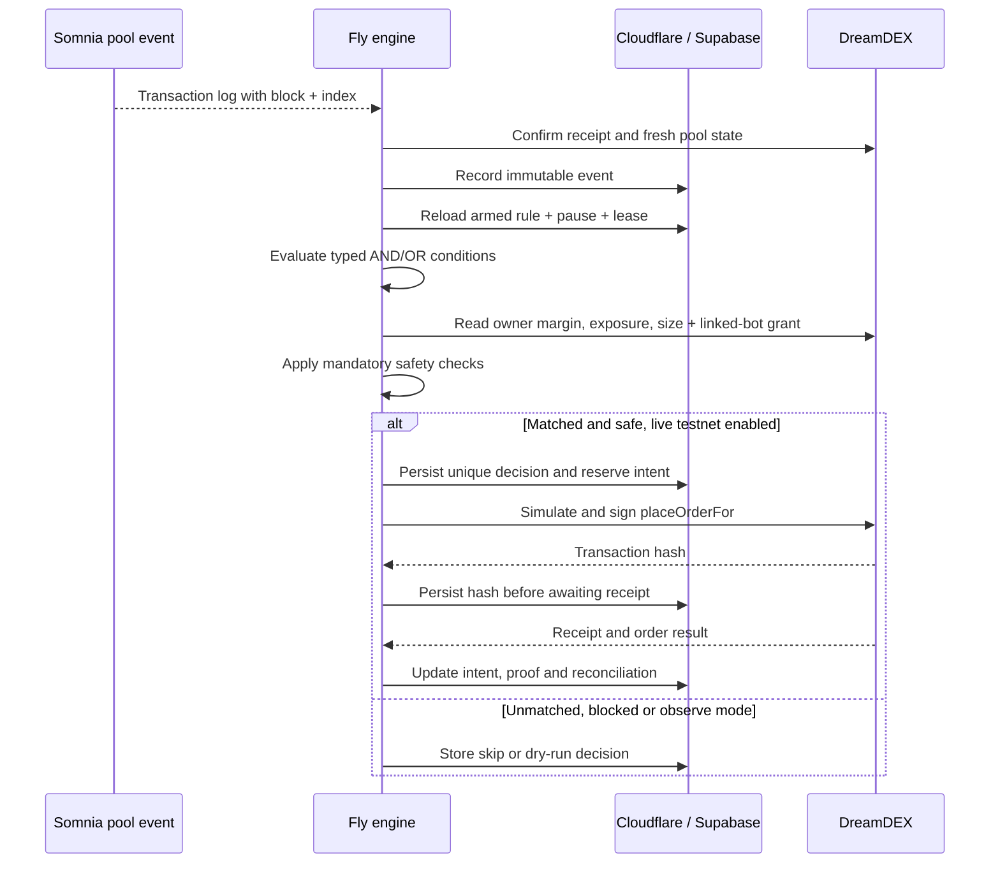

# THRYNT technical architecture

## Boundaries and authority

1. **Public frontend** may read curated market snapshots, recent decisions, and explorer links through Cloudflare. It cannot query application tables directly or submit an onchain transaction.
2. **Authorized trader** signs in through Supabase email OTP. The Worker checks the Supabase Auth user ID against `TRADER_USER_ID` on **every** owner mutation. A draft has no execution authority; simulation and explicit arm are required.
3. **Cloudflare Worker** mediates Supabase writes. A separate 32+ byte engine key authorizes the Fly worker routes. Neither service key is in the Vercel bundle.
4. **Fly worker** maintains outbound chain WebSocket and RPC connections, gathers fresh onchain state, evaluates rules, verifies bot permissions and signs one action at a time. It has a single Postgres-backed execution lease and no incoming trade endpoint.
5. **DreamDEX** enforces wallet linkage, pool rules, margin and settlement. THRYNT risk caps provide defense in depth but **cannot prevent abuse after compromise of a granted bot private key**.

## Event-to-order lifecycle

### Honest proof labels

- **Observed**: app read a pool log and collected market snapshots.
- **Matched**: app reports deterministic comparison against its stored rule.
- **Risk blocked**: a named mandatory gate prevented an action.
- **Reserved**: DB intent inserted under a unique key; NOT a blockchain transaction.
- **Submitted**: a broadcast transaction hash exists; receipt/fills NOT yet established.
- **Confirmed**: transaction succeeded onchain, which does not imply the full order filled.
- **Unknown**: send/reconciliation uncertainty, requires investigation before new live trading.

### Entry versus position management

Entry uses the verified linked-bot `placeOrderFor` route after the independent risk gateway and durable intent reservation. Position management is a separate authority boundary: DreamDEX's linked-bot `reduceOrderFor` reduces a resting order, not a filled perpetual position. The ETH Hideki stop registry was read directly and the owner-to-registry placement authorization was not enabled during verification. THRYNT therefore exposes authoritative position and order telemetry, but blocks close/reduce broadcasts and does not emulate reduce-only with an opposite-side order. Exchange-held TP/SL or bot-monitored exits can only be enabled after the exact owner-authorized reduce-only mechanism is proven and reconciled.

Live order history must distinguish successful resting orders, partial fills, canceled orders, IOC no-fill reverts, and failed receipts using indexed history and/or pool logs. The public trace may initially show only a receipt summary until reconciliation is validated.

## Risk rules

Market inputs are *conditional*. These may be joined by AND or OR. They are never safety exemptions.

Independent hard conditions:

1. Rule is armed, current version, not expired; account global pause is off.
2. Engine lease and heartbeat healthy; event fresh, known, non-replayed and confirmed.
3. Bot signer distinct from the owner and authorized on the exact live pool.
4. Market mark/index feeds priceable; fresh chain state and correct network.
5. Market base decimals, quantity minimum, tick and lot grids satisfied.
6. Margins and account exposure checked using current MarginBank state, not stale indexed rows.
7. User max notional, exposure, minimum margin, per-day actions and cooldown respected.
8. `getMaxPerpOrderSize` reports priceable/placeable and permits full intended quantity.
9. Supabase reservation succeeds once with a unique hash for (version, event, action).
10. No unresolved transaction or ambiguous nonce state at engine startup.

### Failure policy

**Fail closed** on any missing feed, unknown pool, stale oracle, Supabase outage, linked permission uncertainty, engine lease conflict or unknown transaction. Never automatically retry an order whose broadcast result is unknown. Historical logs recovered after a subscription outage may be recorded but never trigger late trades.

All application events and decisions are offchain records. To claim cryptographic evidence of rule decisions would require additional attestations or reproducible independently captured inputs; THRYNT does not make that claim.
